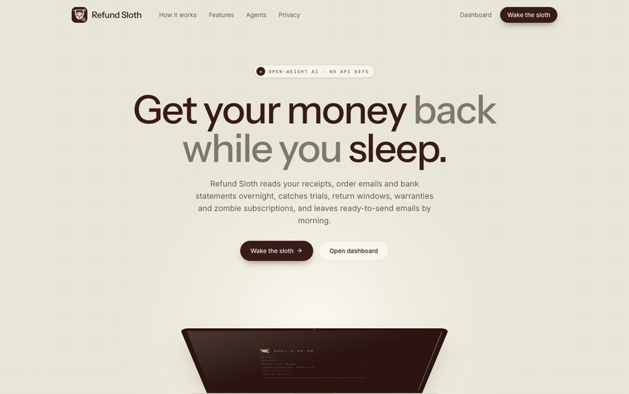
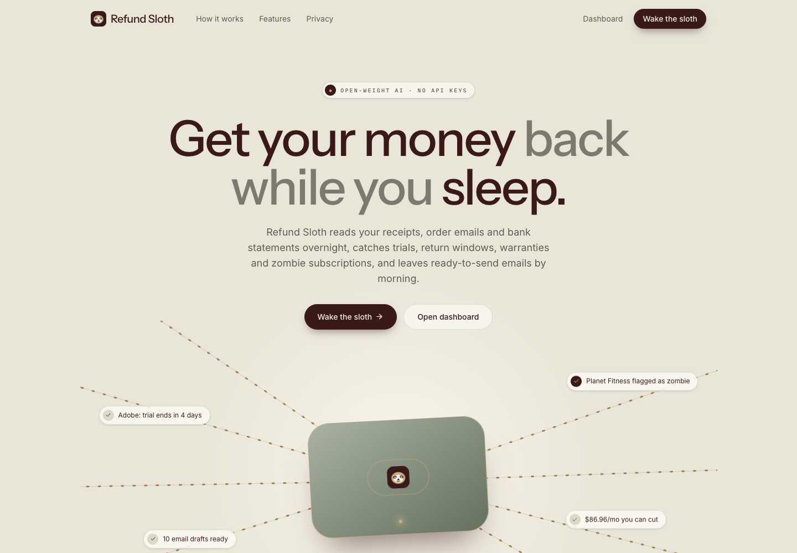
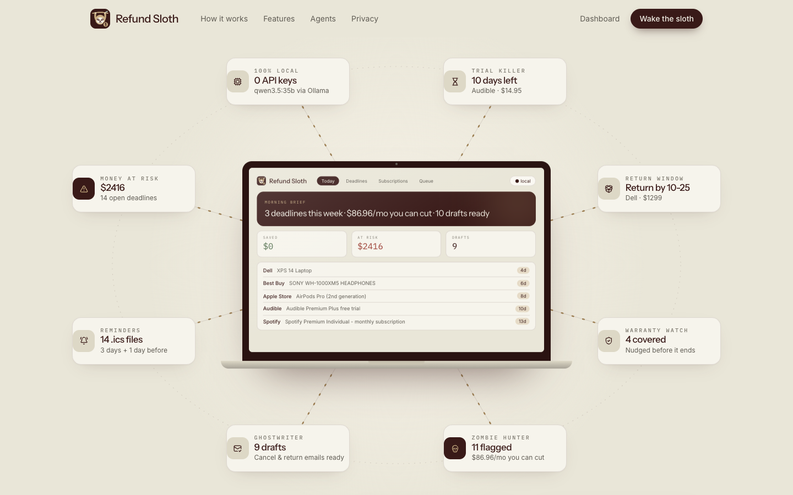
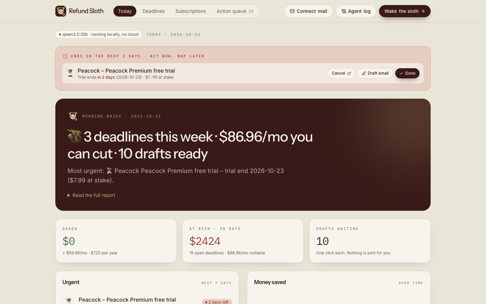
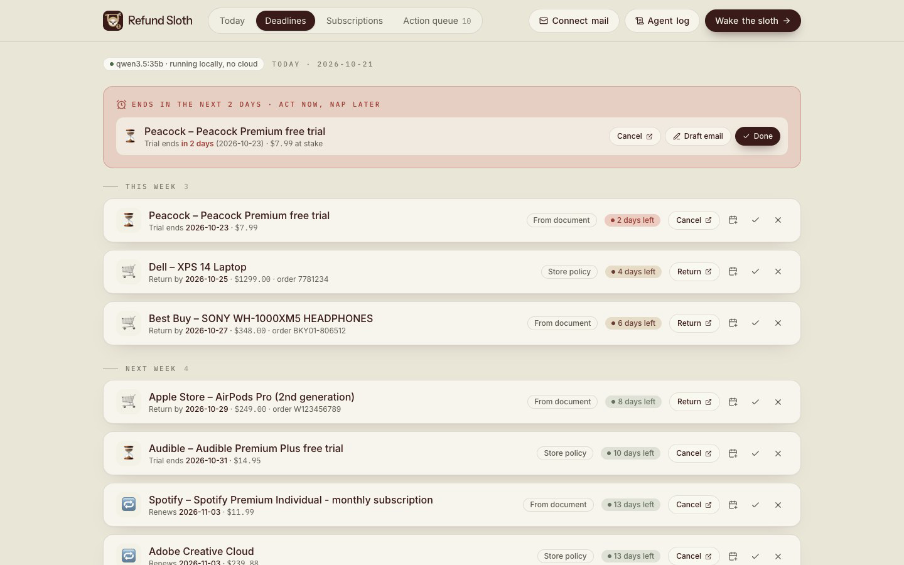
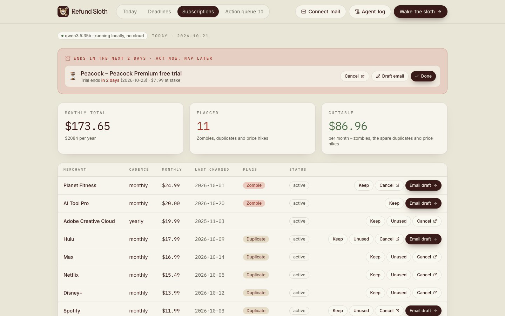
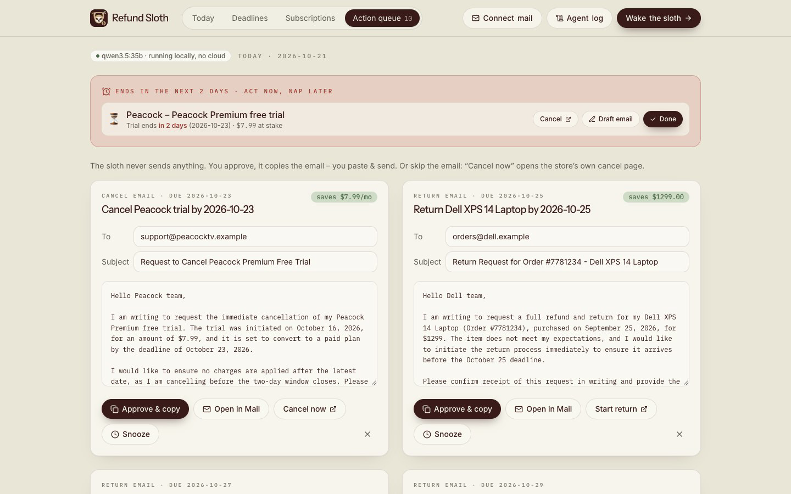
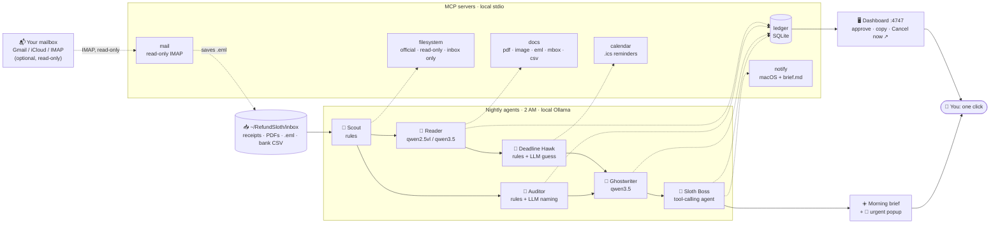

# 🦥 Refund Sloth

**Local AI agents that get your money back while you nap.** Drop receipts, order emails and bank statements into a folder. Overnight, a team of open-weight models running on *your* laptop finds forgotten free trials, closing return windows, expiring warranties and zombie subscriptions, then drafts the cancellation and return emails for you. In the morning you click **Approve**.

No API keys. No cloud. $0 per run. Works with Wi-Fi off.

## 🎬 Demo


▶️ Full-quality video: [docs/media/refund-sloth-demo.mp4](docs/media/refund-sloth-demo.mp4) (26 s, demo data, fake "today" = 2026-10-21)

## 📸 Screenshots
| Landing | Scroll: the laptop orbit |
|---|---|
|  |  |
| **Today: urgent banner + morning brief** | **Deadlines** |
|  |  |
| **Subscriptions: zombies, duplicates, price hikes** | **Action queue: drafts you approve** |
|  |  |

> All data in the demo is fake (`eval/fixtures`). No real receipts or bank statements are in this repo.

Open `http://localhost:4747` for the landing page; the dashboard lives at `http://localhost:4747/#today`.

## Why
- 48–79% of people have paid for a free trial they forgot to cancel, losing roughly **$187–$540 a year**.
- People think they spend about $86/mo on subscriptions; the real number is about $219.
- 44% keep a subscription only because cancelling is a hassle.

Your receipts and bank statement are the most private data you have. They should never leave your machine to get this done.

## What it does
| | |
|---|---|
| 📥 **Drop folder** | `~/RefundSloth/inbox`: JPG/PNG receipts, PDF invoices, `.eml`/`.mbox` emails, bank CSVs. Hash-deduplicated. |
| 📖 **Reads anything** | A local vision model reads receipt photos; a text model reads PDFs and emails. Output is strict, validated JSON. |
| 🦅 **Deadlines** | Trial ends, return-by, warranty-until, renewals. Uses the document first, then `policies.json`, then a clearly marked AI guess. |
| 🧾 **Subscription audit** | Finds recurring charges in your bank CSV and flags 🧟 zombies, 👯 duplicates and 📈 price hikes. |
| 👻 **Ghostwriter** | Ready-to-send cancel/return emails (tone: polite, firm or "karen" 😄). |
| 📅 **Reminders** | `.ics` files with alarms 3 days and 1 day before, plus macOS notifications. |
| ☀️ **Morning brief** | "🦥 3 deadlines this week · $86.96/mo you can cut · 10 drafts ready". |
| ✅ **You stay in charge** | Nothing is ever sent or paid. Approve = copy to clipboard / open in Mail. |
| 💰 **Savings tracker** | Saved so far vs. money at risk. |
| ⏰ **Runs itself** | Nightly at 2 AM via launchd (even with the app closed) or the in-app cron. |
| 📬 **Mail sync (optional)** | Connect Gmail/iCloud/Outlook/any IMAP with an app password. Read-only: pulls only receipt/trial/subscription emails from the last 60 days into the inbox. Nothing is marked as read. |
| 🚨 **Urgent alerts** | Anything ending within `urgentDays` (default 2) gets its own macOS popup and a red banner at the top of the dashboard. |
| ↗️ **Cancel now** | One-click links to the store's cancel/return page (`links.json`), next to every deadline, subscription and draft. |

## Architecture


Every agent talks to tools over the **Model Context Protocol**. The LLMs run in **Ollama**. Rule-based code does all date math and money totals, so numbers are never hallucinated; the models do the reading, guessing, naming and writing. See [DECISIONS.md](DECISIONS.md).

| Agent | Model (full profile) | Job |
|---|---|---|
| Scout | – (rules) | find new files, classify them |
| Reader | `qwen2.5vl:7b` (images), `qwen3.5:35b` (text) | extract merchant, item, amount, dates, policy text |
| Deadline Hawk | rules, `qwen3.5:35b` for unknown stores | compute deadlines, create reminders |
| Auditor | rules, `qwen3.5:35b` for naming | recurring charges, zombie/duplicate/price flags |
| Ghostwriter | `qwen3.5:35b` | draft emails |
| Sloth Boss | `qwen3.5:35b` (tool calling) | review the ledger, write the brief |

## Setup (macOS)
```bash
brew install ollama            # or the app from ollama.com
ollama serve &                 # if not already running
ollama pull qwen3.5:35b
ollama pull qwen2.5vl:7b

git clone <this repo> refund-sloth && cd refund-sloth
npm install
npm run build                  # type-check + build the dashboard
npm run sloth -- init          # creates ~/RefundSloth and a config
npm run sloth -- doctor        # all green?
npm run sloth -- demo --serve  # fake data, today = 2026-10-21, opens the dashboard
```
Tip: `alias sloth="npm run --silent --prefix ~/refund-sloth sloth --"`.

### Connect your mailbox (optional)
Rather not forward emails by hand? Let the sloth fetch them:
1. Gmail: turn on 2-Step Verification, then create an **app password** at <https://myaccount.google.com/apppasswords> (iCloud: appleid.apple.com → App-Specific Passwords).
2. Dashboard → **Connect mail**, or `npm run sloth -- mail connect`.

Every nightly run then syncs before the Scout agent. The mailbox is opened **read-only** and only matching emails (receipts, orders, trials, renewals) are saved as `.eml` files in the inbox. The password lives in the **macOS Keychain** (or `SLOTH_IMAP_PASSWORD`), never in a file. Skip with `SLOTH_NO_MAIL=1`; remove with `sloth mail disconnect`.

### Smaller laptop? Use the Lite profile (8–16 GB RAM)
```bash
ollama pull qwen3:8b && ollama pull qwen2.5vl:3b
SLOTH_PROFILE=lite npm run sloth -- run     # or set "profile": "lite" in ~/RefundSloth/sloth.config.json
```
There's also a `single` profile that uses only `qwen3.5:35b` (it has vision too): one download.

## Commands
| Command | |
|---|---|
| `sloth init` | create folders + config, check models |
| `sloth doctor [--allow-remote]` | Node, Ollama, models (vision/tools), DB, MCP servers, **fails if Ollama isn't on localhost** |
| `sloth run [--dry-run] [--today YYYY-MM-DD]` | run the pipeline now with a live agent log |
| `sloth brief` / `sloth queue` | latest brief / pending drafts |
| `sloth approve|dismiss <id>`, `sloth snooze <id> [days]` | decide (approve copies the email + prints a `mailto:`) |
| `sloth serve [--port 4747] [--no-schedule]` | dashboard + API + nightly cron |
| `sloth schedule install|uninstall` | launchd job at 02:00 (`~/Library/LaunchAgents/dev.refundsloth.nightly.plist`) |
| `sloth demo [--serve]` | copy fake fixtures into the inbox and run |
| `sloth eval` | accuracy on fixtures → `eval/RESULTS.md` |
| `sloth mail connect|sync|status|disconnect` | optional read-only IMAP sync (Gmail, iCloud, Outlook, any IMAP) |
| `sloth reset --yes` | wipe DB/reminders/reports (never the inbox) |

## Accuracy (local, M3 Max, full profile)
| Metric | Score |
|---|---|
| Field accuracy (merchant / amount / date) | **96.7%** |
| Deadline accuracy (type + date ±1 day) | **100%** |
| Subscription recall / flag accuracy | **100% / 100%** |
| False positives | 0 |

Full table: [eval/RESULTS.md](eval/RESULTS.md). Run your own with `npm run eval` (add `-- --profile lite` to compare).

## Privacy
- **Stays local:** everything. Files, extracted data, SQLite DB, drafts, reminders, model weights.
- **Sent anywhere:** nothing. The only network connection is to Ollama on `127.0.0.1` (`sloth doctor` fails if you point it elsewhere), plus, only if you opt in, a read-only IMAP login to *your own* mail server.
- Mail sync uses no OAuth app, cloud project or API key. The app password stays in the Keychain, and messages are never modified.
- The filesystem MCP server is rooted at the inbox and only its read-only tools are exposed.
- The dashboard API listens on `127.0.0.1` and rejects requests with a non-localhost `Host` header.

## Customise
- **Swap models:** edit `profiles` in `~/RefundSloth/sloth.config.json` (any Ollama model; vision for `reader_vision`, tool calling for `boss`). Or build your own with [`models/Modelfile`](models/Modelfile), even a fine-tune on your receipts.
- **Add a store policy:** add to `policies.json`, e.g. `"rei": { "returnDays": 365, "warrantyMonths": null, "trialDays": null }`.
- **Add a cancel/return link:** add to `links.json`, e.g. `"rei": { "return": "https://www.rei.com/help/returns" }`.
- **Tone / urgent window / schedule / reminder days / zombie threshold:** `ghostwriterTone`, `urgentDays`, `schedule`, `reminderDaysBefore`, `zombieDays` in the config.

## Development
```bash
npm test               # vitest: rules, ledger, parsers, ICS, MCP smoke test (no LLM needed)
npm run typecheck
npm run dev:dashboard  # Vite on :5173, proxies /api to :4747 (run `sloth serve` too)
npm run fixtures       # regenerate fake fixtures
```

## Limitations
- It never sends email and never cancels for you: stores have no cancel API, so "Cancel now" opens the store's page and you click the last button (on purpose).
- Mail sync is tested against the IMAP helpers; Gmail needs an app password (2-Step Verification on).
- Scanned (image-only) PDFs: export the page as an image and drop that in.
- Policy-based dates are estimates; "AI guess" dates especially. Check them.
- The bank CSV parser auto-detects common column layouts; exotic exports may need a tweak.
- The scheduler installer is macOS (launchd); `sloth serve` cron works everywhere.

## License
MIT. All fixtures in `eval/fixtures` are fake.
